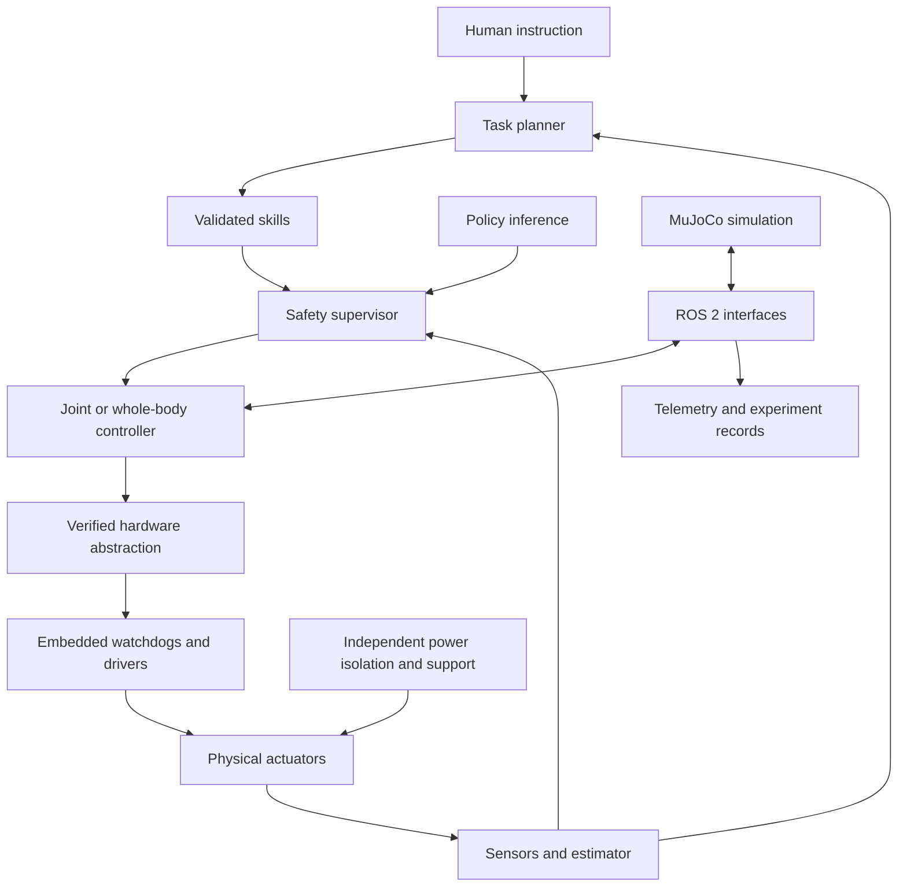
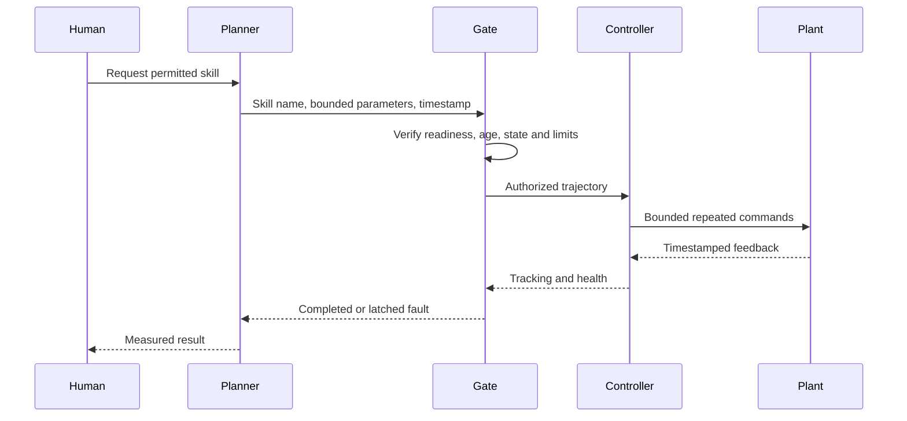
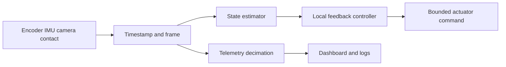

# Appendices - Reproducibility and evidence
## Appendix A. Complete numerical and fault tests
The regression suite intentionally tests meaningful model and interface properties rather than mirroring every line of implementation. Run it from humanoid_lab with the pinned environment. These tests do not prove physical safety, successful ROS integration, learned walking or real camera performance.
File: /data/Robotics_Project/humanoid_lab/tests/test_core.py
!code humanoid_lab/tests/test_core.py
File: /data/Robotics_Project/humanoid_lab/tests/test_contracts.py
!code humanoid_lab/tests/test_contracts.py

## Appendix B. Measured preparation results
The following results were observed while preparing this edition, using the pinned checkout and CPU teaching environment. They are evidence about the included software, not a performance guarantee for every workstation. The initial full test suite passed seven tests. The final preparation suite and artifact checks are recorded in validation_report.json beside the manuscript.

| Experiment | Measured outcome | Interpretation |
|---|---|---|
| Supported model load | nq=25, nv=25, nu=25 | Adapter and actual asset agree on scalar coordinates |
| Ten-second joint run | 5,000 samples, 2 ms physics step | Headless stepping/logging executes |
| Elbow tracking | RMSE about .01213 rad | Below the .1 rad exercise threshold |
| Elbow speed | Peak about .15508 rad/s | Measured simulation result, not a physical limit |
| Elbow torque command | Peak about 1.22718 Nm | Applied teaching command, not measured physical torque |
| Nearby wrist position IK | Residual about .00006504 m | Numerical position-only solve converges |
| Synthetic perception | Centroid near (210,110), unknown depth retained | Correct positive test and explicit uncertainty |
| Supported object gesture | 1,500 physics steps, COMPLETE_SIMULATION | Perception-to-control software chain executes |
| Passive unsupported trials | Five of five fell around .50-.52 s | No standing capability demonstrated by passive model |
| PPO smoke training | 2,048 timesteps, one training seed | Training pipeline check only |
| PPO held-out reach evaluation | Mean final error about .03744 rad over 20 seeds | Does not pass proposed .03 rad gate |
| Policy export | Traced actor saved; sample and 100 rollout comparisons pass | External action clipping retained; hardware replay still required |
| Procurement audit | EUR 189 known subtotal; many unknowns | Full-robot feasibility remains unestablished |
| Commissioning audit | No-go with NOT_TESTED defaults | No physical commissioning claimed |
| ROS integration | Source supplied and syntax inspected | Runtime integration requires reader-side Jazzy testing |

The policy evaluation's zero fall fraction is trivial for supported reach. It is not a standing metric. The environment's observations and inner-loop model are idealized. Do not deploy the smoke-trained actor on hardware.

### Rendered model and telemetry
!image humanoid_lab/logs/asimov_model.png
Figure B1. Actual pinned Asimov geometry rendered in the teaching fixture. Geometry comes from the upstream source under its published hardware license; this is a simulation view, not a photograph of an assembled robot.
!image humanoid_lab/logs/telemetry.png
Figure B2. Ten simulated seconds of supported elbow tracking, speed and applied teaching torque. The plots are generated from the supplied CSV.

## Appendix C. Live telemetry and model-rendering utilities
For a simple live dashboard, start python simulate.py --seconds 60 in one terminal and python live_dashboard.py in a second terminal from the same environment and directory. The simulator flushes its CSV periodically; the dashboard reads a recent window at 4 Hz. It is an observability path and must never become part of the actuator feedback deadline. This live GUI utility is supplied for desktop use; the preparation run verified the saved plot and offscreen model render, not an interactive desktop session.
File: /data/Robotics_Project/humanoid_lab/live_dashboard.py
!code humanoid_lab/live_dashboard.py

For an offscreen geometry check on a machine with EGL support, run MUJOCO_GL=egl python render_model.py. Set the graphics backend before MuJoCo imports. If EGL fails, check the host graphics configuration; headless physics remains available. The rendered geometry was successfully produced during preparation.
File: /data/Robotics_Project/humanoid_lab/render_model.py
!code humanoid_lab/render_model.py

## Appendix D. Mermaid architecture sources
The diagrams in the book are rendered for PDF legibility. These Mermaid sources provide editable text for your project documentation.




## Appendix E. Units, equations and glossary
| Term | Meaning | Practical check |
|---|---|---|
| rad | Radian angle | pi rad is 180 degrees |
| Nm | Torque | 10 N through .1 m gives 1 Nm |
| Hz | Updates per second | 500 Hz corresponds to 2 ms |
| Frame | Named origin and axes | State source and destination on every transform |
| Quaternion | Four-number unit rotation representation | Normalize; verify component order |
| COM | Center of mass | Mass-weighted position; not a physical sensor |
| COP | Center of pressure | Requires contact-load distribution |
| ZMP | Zero Moment Point | Depends on model/contact assumptions |
| URDF | Unified Robot Description Format | Geometry/joint tree does not ensure actuator semantics |
| MJCF | MuJoCo model format | Contains simulator-specific dynamics/settings |
| QoS | Quality of service | Delivery choice does not remove message age |
| PD/PID | Feedback on error, rate, and optionally integral | Units and saturation must be explicit |
| PPO | Proximal Policy Optimization | Algorithm choice does not validate reward design |
| HIL | Hardware in the loop | Specify which outputs are physically inhibited |
| Watchdog | Deadline/freshness monitor | Test the actual fault response |
| E-stop | Emergency stop function | Requires reviewed physical outcome and isolation design |
| Sim-to-real | Transfer of tested behavior across model/hardware differences | Identification, calibration, replay and protected tests |

Useful relationships: angular speed in rad/s is RPM*2*pi/60; linear lever torque is force*perpendicular distance; mechanical power is tau*dq; electrical power is V*I; center of mass is sum(m_i*c_i)/sum(m_i); rigid transform composition follows frame order. A unit conversion error is a control bug even when the program runs without exceptions.

## Appendix F. Source register and update policy
Primary sources were checked for this edition on 25 October 2026. URLs may redirect or change; the local commit snapshot is the authority for file paths used by the code. Sources support specific platform or software facts, while lesson explanations, exercise parameters and proposed gates are original instructional design. Dated price observations must be rechecked before spending.

[S1] Menlo Research Asimov 1 official repository and README. Platform overview, public kit asking price, licenses and public roadmap. https://github.com/menloresearch/asimov-1/

[S2] Pinned simulation README, commit 96a6807c163e4e6cabdc124eefcc45b0ae2cb57a. Variant paths and upstream MuJoCo validation version. https://raw.githubusercontent.com/menloresearch/asimov-1/96a6807c163e4e6cabdc124eefcc45b0ae2cb57a/sim-model/README.md

[S3] Menlo mechanical system tour. Joint layout, parallel ankle distinction and document revision caveats. https://docs.menlo.ai/asimov/1/overview/system-tour/mechanical

[S4] Menlo software system tour. Software roles, release-dependent capabilities, control modes, and DAMP distinction. https://docs.menlo.ai/asimov/1/overview/system-tour/software

[S5] Menlo electrical system tour. Compute/power architecture and unresolved public CAN mapping note. https://docs.menlo.ai/asimov/1/overview/system-tour/electrical

[S6] Official ROS 2 documentation release table, raw source. Support dates including Jazzy and Lyrical. https://raw.githubusercontent.com/ros2/ros2_documentation/rolling/source/Releases.rst

[S7] Official ROS 2 Jazzy Ubuntu installation and repository configuration source. https://raw.githubusercontent.com/ros2/ros2_documentation/jazzy/source/Installation/Ubuntu-Install-Debs.rst
Repository bootstrap details: https://raw.githubusercontent.com/ros2/ros2_documentation/jazzy/source/Installation/_Apt-Repositories.rst

[S8] Gazebo Harmonic documentation, recommended ROS/Gazebo pairings. https://gazebosim.org/docs/harmonic/ros_installation/

[S9] NVIDIA Isaac Sim official requirements. Read the selected release's compatibility matrix before GPU purchasing or installing Isaac Lab. https://docs.isaacsim.omniverse.nvidia.com/latest/installation/requirements.html

[S10] MuJoCo official Python documentation. Model/state APIs, stepping, viewer modes and macOS viewer requirement. https://mujoco.readthedocs.io/en/stable/python.html

[S11] Stable-Baselines3 official custom-environment documentation. Interface expectations and environment checker. https://stable-baselines3.readthedocs.io/en/master/guide/custom_env.html

[S12] Gymnasium official environment API. Reset, step, seeded randomness, termination and truncation. https://gymnasium.farama.org/api/env/

[S13] Menlo part-organization and actuator checklist. Actuator-family counts used in procurement ledger. https://docs.menlo.ai/asimov/1/build/assembly-preparations

[S14] BerryBase direct Raspberry Pi 5 8 GB product listing. EUR 189.00 VAT-inclusive observed on the preparation date, shipping extra; this is not a complete-robot quotation. https://www.berrybase.de/raspberry-pi-5-8gb-ram

[S15] Menlo official actuator-ID assignment procedure. Confirm applicability to the purchased hardware release. https://docs.menlo.ai/asimov/1/build/assembly-preparations/assign-actuator-ids

[S16] Direct upstream GitHub tree snapshot and local checkout used for the asset audit. https://api.github.com/repos/menloresearch/asimov-1/git/trees/96a6807c163e4e6cabdc124eefcc45b0ae2cb57a?recursive=1

[S17] Original 25-DOF MJCF source at the pinned revision; authoritative for this lab's modeled limits and names. https://github.com/menloresearch/asimov-1/blob/96a6807c163e4e6cabdc124eefcc45b0ae2cb57a/sim-model/asimov_1_25dof/xml/asimov_1_25dof.xml

When updating, preserve this edition and its logs. Record the new commit and diff model joints, limits, masses, collision geometry, sensors and actuator semantics. Recreate the environment, rerun regression tests, then revisit any physical calibration or safety assumption affected by the change. A newer version is an experiment to validate before it becomes a release.

## Appendix G. Expanded-edition numerical validation
The extended numerical laboratory comprises 70 distinct standalone modules and 420 published parameter cases. All cases were executed during preparation with finite reported metrics. The combined pytest suite passed 101 tests, including the original humanoid numerical tests, module-to-catalog parity for every six-case study, and independent reference or cross-case checks for conservation, frame round trips, singularity behavior, timing, uncertainty, budgets, message integrity and fault handling.

These results establish execution and selected numerical properties of the stated models. They do not certify physical structures, electrical designs, protective systems, real sensors or locomotion. The synthetic capstone, packet format, fault probabilities, costs and thresholds remain explicitly educational. Actual hardware commissioning status is unchanged: no physical actuator was connected by this work.

The full semantic test file is printed here so the reader can distinguish a meaningful physical or numerical invariant from a simple assertion that a program returned a finite number. The 70 parametrized tests compare each formatted standalone module against its catalog reference over all six declared configurations. The additional tests check independent properties. Passing these tests is a prerequisite for accepting edited numerical fixtures, not a substitute for validation against real measurements.
!code expanded_lab/test_textbook.py

Run the complete numerical validation and the original humanoid checks with:
```bash
cd /data/Robotics_Project
.venv-book/bin/python -m pytest -q expanded_lab/test_textbook.py humanoid_lab/tests
.venv-book/bin/python expanded_lab/run.py test_all --output expanded_lab/results/recheck.json
```
For reproducibility, retain expanded_lab/results/textbook_cases.json, the standalone module sources, the environment lock from the practical project and the book's validation manifest. An experiment's graphs are derived from those numerical cases. Do not edit a graph's data independently of its source experiment.

## Appendix H. Additional primary learning resources
The extended equations and code are original teaching implementations. The following primary resources support deeper study and alternative reference implementations. They do not establish hardware compatibility for the Asimov build.

[T1] Kevin M. Lynch and Frank C. Park, Modern Robotics, Northwestern University video supplement on homogeneous transformations. Use it to compare frame notation, composition and inversion with the transform laboratory. https://modernrobotics.northwestern.edu/nu-gm-book-resource/3-3-1-homogeneous-transformation-matrices/

[T2] Modern Robotics, Northwestern University video supplement on the space Jacobian. The spatial-twist Jacobian discussed there is distinct from the two-dimensional endpoint-position Jacobian used in the small numerical laboratory. Verify the represented velocity, frame and column convention before comparing implementations. https://modernrobotics.northwestern.edu/nu-gm-book-resource/5-1-1-space-jacobian/

[T3] John Schulman and colleagues, Proximal Policy Optimization Algorithms, 2017. The paper supplies the algorithmic context for the clipped-surrogate exercise; that exercise implements only the stated batch objective, not the complete training algorithm. https://arxiv.org/abs/1707.06347

[T4] SciPy official Rotation API reference. This provides a library implementation for rotations and highlights component-order conventions. The extended NumPy laboratories deliberately implement small formulas directly for instruction and do not add SciPy as a dependency. https://docs.scipy.org/doc/scipy/reference/generated/scipy.spatial.transform.Rotation.html

Use established numerical and robotics libraries when building a larger system after you understand their assumptions. A hand-written educational routine is useful for learning and regression fixtures, but does not automatically become the best production implementation.
